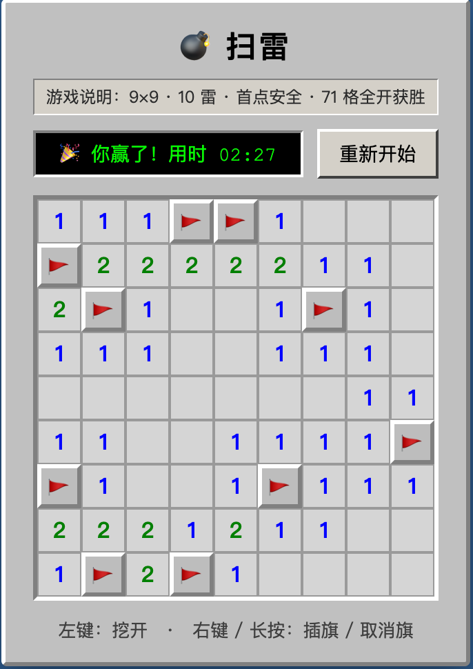

# 💣 扫雷 · 基础版（经典 9×9）

> 这么多年都不会，自己做了一个扫雷游戏，终于把扫雷游戏会玩了。

零依赖、零构建的网页版经典扫雷：双击 `index.html` 就能玩。

**在线试玩**：<https://mirrorkang.github.io/game-minesweeper/>



## 玩法

- 9×9 棋盘、10 颗雷，挖开全部 71 个安全格即获胜
- **首点安全**：第一下点击的格子及其周围 8 格保证没有雷
- **左键 / 轻点**：挖开格子；挖到地雷即失败
- **右键 / 触屏长按**：插旗 / 取消旗
- **计时**：第一下点击开始计时，状态栏实时显示；胜利 / 失败时显示本局用时
- **胜利**：剩下的雷自动补旗；**失败**：所有雷翻开，插错的旗会标红
- 顶部「游戏说明」一栏常驻显示棋盘规格与获胜条件

## 打开方式

**不需要安装任何依赖**，双击打开 `index.html` 即可游玩，或：

```bash
cd game-08-minesweeper-base
python3 -m http.server 8000   # 可选：本地静态服务器
# 浏览器访问 http://localhost:8000
```

## 项目结构

```
game-08-minesweeper-base/
├── index.html      # 页面结构
├── css/style.css   # 经典 Win98 立体样式（窄屏自动收小）
└── js/
    ├── game.js     # 纯逻辑：布雷、首点安全、连锁展开、胜负判定
    ├── board.js    # 棋盘渲染与交互：左键挖开、右键 / 长按插旗、无障碍标签
    └── main.js     # 状态栏、计时、重新开始
```

## 版本说明

本仓库是第一版「基础版」：经典 9×9 单关卡。第二版「双关卡版」新增「矿洞夜行」12×12、护盾、最佳成绩等，仍在确认中，暂未开放。

## 兼容性

- Chrome / Edge / Safari 最新版；手机浏览器可以直接玩
- 触屏长按插旗（约 0.4 秒），滑动不会误触
- 视口宽度 ≤ 339px 时棋盘自动从 32px 缩到 28px 一格，不会横向滚动

## 范围说明

本版保持「经典、简单」的定位：固定 9×9 / 10 雷，不含难度选择、问号标记、和弦操作和音效。

## 版权

© 2026 康一夏 · 保留所有权利。仅限亲子共玩、课堂演示与个人体验，未经书面许可请勿商用、二次分发或删除版权标识。
